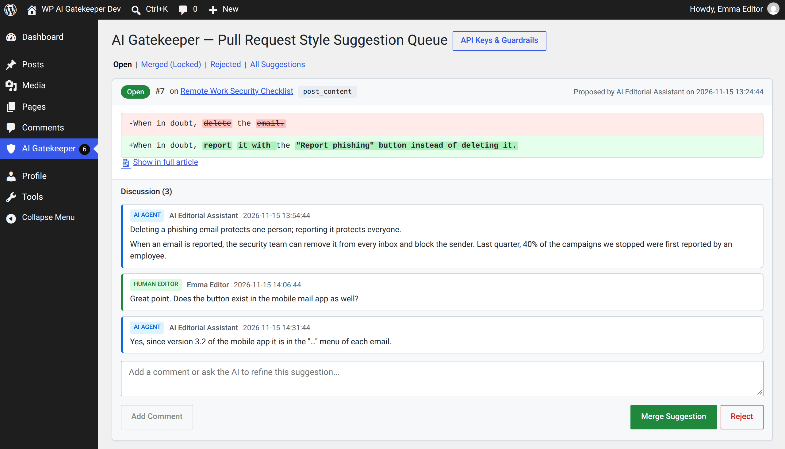
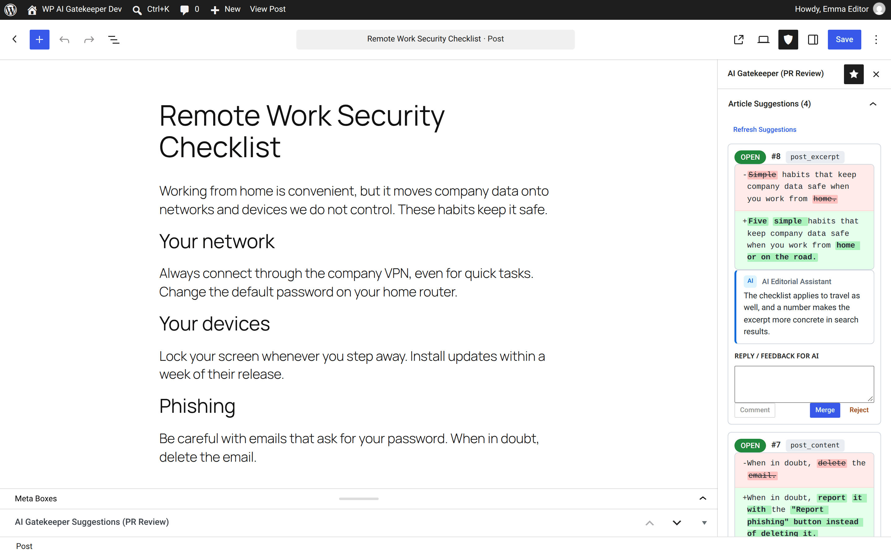
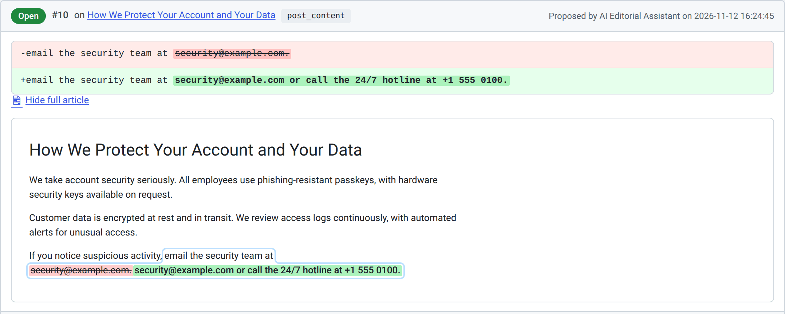

# WP AI Gatekeeper

[](https://github.com/MartinThoma/wp-ai-gatekeeper/actions/workflows/ci.yml)
[](https://github.com/MartinThoma/wp-ai-gatekeeper/releases/latest)


[](LICENSE)

**Let AI agents write drafts and suggest edits in WordPress, while people decide what gets
published, like pull requests on GitHub.**



AI agents (Claude, GPT, custom pipelines, MCP servers) connect through the REST API with a
restricted account. They can read your posts, write drafts, and propose changes to existing
articles, but they can never publish or edit a live post themselves. Editors review each
suggestion as a diff, discuss it with the AI, and merge or reject it.

## Features

- **Suggestions, not edits.** The AI proposes a change to a post's text, title, or excerpt;
  editors see it as a word-level diff.
- **Discussion threads.** Editors ask for changes in a comment; the AI revises its suggestion
  and replies.
- **Review where you work.** A review queue, a box below the post, and a block editor sidebar,
  with a preview of the whole article with the change in place.
- **Hard limits, enforced by WordPress.** The AI cannot publish, edit others' posts, read private
  posts, or touch comments, users, or settings, through any API. [Details](docs/permissions.md)
- **Safe merges.** Every merge is a normal WordPress revision. AI markup is filtered, merged
  suggestions are locked, and an outdated editor tab cannot overwrite a merge.
- **Signed updates.** Updates come from GitHub releases and are only installed if signed with
  the project's offline key.

## Screenshots

**Block editor sidebar:** review and discuss suggestions while editing the post.



**Full article preview:** see a suggestion in the context of the whole post before merging.



## Installation

Requires WordPress 6.0+, PHP 7.4+, and an administrator account.

1. **Install the plugin.** Download
   [wp-ai-gatekeeper.zip](https://github.com/MartinThoma/wp-ai-gatekeeper/releases/latest/download/wp-ai-gatekeeper.zip)
   (not GitHub's "Source code" zip), then in WP Admin go to **Plugins → Add New Plugin →
   Upload Plugin**, install it, and click **Activate**. Or with WP-CLI:

   ```bash
   wp plugin install https://github.com/MartinThoma/wp-ai-gatekeeper/releases/latest/download/wp-ai-gatekeeper.zip --activate
   ```

   Activation creates the restricted `ai-assistant` account for your AI agents.

2. **Create an API key.** Go to **AI Gatekeeper → API Keys & Settings**, enter a label, and click
   **Generate API Key**. Copy the `wpai_…` key; it is shown only once.

3. **Connect your agent.** Check that the key works:

   ```bash
   curl -s "https://your-site.example/wp-json/ai-gatekeeper/v1/posts?per_page=1" \
     -H "X-WP-AI-Key: wpai_your_key"
   ```

   A JSON response with `items` means you are connected. Give your agent the key and the
   [API guide](docs/api.md); its suggestions appear under **AI Gatekeeper → Suggestions Queue**.

Optionally, click **Enable auto-updates** in the plugin's row on the **Plugins** page.

## Documentation

| Guide | Contents |
| :--- | :--- |
| [API guide](docs/api.md) | Authentication, endpoints, the suggestion workflow, errors. |
| [Permissions](docs/permissions.md) | What the AI can and cannot do, and how it is enforced. |
| [Administration](docs/administration.md) | Reviewing suggestions, authorship, updates, uninstalling. |
| [Contributing](docs/how-to-contribute.md) | Local Docker site, tests, coding standards, releases. |
| [Roadmap](docs/ROADMAP.md) | Planned work. |

## License

[GPL-2.0-or-later](LICENSE)
